# 🙋‍♂️ About Me

Hi, I'm Dimitris 👋

I'm a Mechanical Engineer specializing in mechanical design, robotics and control, with hands-on experience in AI/ML and intelligent control systems. These days, I'm building robots for space. My work brings together dexterous manipulation, multibody dynamics, learning-based control and safety-critical systems... honestly, I could go on all day. In short, I love designing systems where hardware and software have to be solved together to work in the real world, or beyond it.

Here you'll find projects exploring motion planning, control, simulation and machine learning. Some may help you tackle a familiar problem or save time on an algorithm you'd rather not reinvent. Others explore ideas and use cases that I hope will inspire you to build something of your own. Feel free to look around, explore the code and make use of whatever you find!

## 📊 GitHub Stats

  
  

